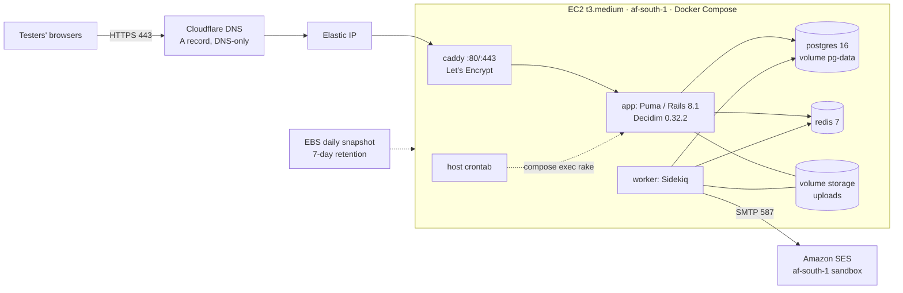

# feat: Build and deploy a Decidim 0.32.2 demo on a single AWS EC2 host

---

## Summary

Stand up a throwaway-grade but secure Decidim **v0.32.2** demo for a handful of OCL testers (and possibly a CCT tender demo), with minor OCL theming. One EC2 instance in **af-south-1** runs everything under Docker Compose — Rails/Puma, Sidekiq, PostgreSQL, Redis, and Caddy for automatic HTTPS. DNS lives in Cloudflare; email goes through Amazon SES (sandbox). The image is built from a Decidim app generated into this repo, because **no official `decidim/decidim:0.32.x` image exists** (Docker Hub tops out at `0.31.6`, checked 2026-11-03).

---

## Problem Frame

OCL needs a working Decidim instance on the latest release to explore features, theme it, and potentially show it to City of Cape Town (tender 92S/2026/27). It is a demo: a couple of users, no SLA, no real citizen data. The goal is the least moving parts that are still safe to expose on the public internet.

---

## Requirements

- **R1.** Runs Decidim exactly at v0.32.2 (gems pinned), not `develop`.
- **R2.** Reachable over HTTPS at an OCL subdomain managed in Cloudflare.
- **R3.** Testers can register/confirm by email, or be created by an admin when email is unavailable.
- **R4.** OCL theming (logo, favicon, brand colours `#FCAF00` / `#D86139` / `#2F3542`) applied via the admin "Appearance" settings — no code overrides.
- **R5.** Background jobs and Decidim's scheduled tasks run.
- **R6.** Secrets never committed; server secrets live only on the host.
- **R7.** Follows the deploy-relevant rules in the Decidim repo's `.ai/security.md` (no seed/default accounts, forced SSL, private file serving, rate limiting, system panel locked down).
- **R8.** Cheap to run and trivially stoppable/destroyable; all AWS resources tagged so they are distinguishable in a shared AWS account.

---

## Scope Boundaries

**In:** app generation, container image, Compose stack, one EC2 host, Cloudflare DNS, SES sandbox, cron tasks, daily EBS snapshots, bootstrap of system admin + one organization + testers, teardown runbook.

**Out (non-goals):** high availability, autoscaling, RDS/ElastiCache, S3/CloudFront storage, IaC (Terraform/CDK), CI/CD pipeline, monitoring beyond basic CloudWatch status alarm, real citizen data, custom Decidim modules.

### Deferred to Follow-Up Work

- Afrikaans / isiXhosa translations (tender gap — no `af`/`xh` locales exist at v0.32.2; would go in the app's `config/locales` and upstream via Crowdin).
- Custom SCSS / view overrides beyond admin-panel theming.
- GitHub Actions → ECR image build (replace on-host builds once the demo stabilises).
- Production-grade architecture (Fargate/RDS/ElastiCache/private S3) if the tender is won.

---

## Key Technical Decisions

- **KTD1. Generate our own app and build our own image.** No official 0.32.x image exists. Generate with the Decidim generator pinned to 0.32.2, `--queue sidekiq`, default `local` storage. Run the generator inside a `ruby:3.4.7` container so no local Ruby is needed on Windows (Ruby is not installed locally).
- **KTD2. Single EC2 + Docker Compose**, `t3.medium` (2 vCPU / 4 GB) + 2 GB swap, 40 GB gp3, Ubuntu 24.04, Elastic IP. Rationale: fewest services; asset precompile needs ~3–4 GB RAM, hence swap.
- **KTD3. Build on the host** (`docker compose build` after `git pull`) rather than a registry. Avoids ECR + instance-role IAM work (our IAM user can't even list its own policies, so role creation is uncertain). Revisit under Deferred.
- **KTD4. Uploads on local disk (Docker volume), not S3.** Sidesteps the generator's `AWS_PUBLIC=true` default and the upstream doc advice to disable S3 Block Public Access, which conflicts with `.ai/security.md` §5. Private files (ID docs, exports) are still streamed through Decidim's `PrivateDownloadsController`.
- **KTD5. Caddy for TLS with Let's Encrypt HTTP-01; Cloudflare record DNS-only (grey cloud).** Proxied mode creates a cert chicken-and-egg with "Full (strict)" and hides client IPs from rack-attack. Can switch to proxied later with Cloudflare IP ranges as Caddy trusted proxies.
- **KTD6. SES sandbox in af-south-1** with a verified sending domain (DKIM CNAMEs written via the Cloudflare API) and each tester address verified. Requires a dedicated least-privilege IAM user (`ses:SendRawEmail` only) for SMTP credentials — **must not** reuse the operator key on the server. If IAM user creation is denied, fall back to creating testers via the Rails console (R3 fallback).
- **KTD7. Scheduled tasks via host crontab** calling `docker compose exec -T app bin/rails …` — the upstream cron list, minus initiatives tasks unless that module is enabled.
- **KTD8. Admin access hardening:** `DECIDIM_SYSTEM_ACCESSLIST_IPS` restricted to OCL IPs, SSH (22) limited to OCL IP in the security group, no `db:seed` in production.

---

## High-Level Technical Design



---

## Output Structure

```text
decidim-demo/
├── .env.example            # local operator creds template (AWS, Cloudflare)
├── .gitignore
├── README.md               # runbook: build, deploy, bootstrap, teardown
├── Dockerfile              # multi-stage: build (gems + node + assets) → runtime (libvips)
├── docker-compose.yml      # app, worker, db, redis, caddy
├── Caddyfile
├── deploy/
│   ├── env.production.example   # server-side app env template (no values)
│   ├── crontab                  # Decidim scheduled tasks
│   ├── user-data.sh             # EC2 bootstrap: docker, swap, ufw-free (SG does it)
│   ├── provision.sh             # AWS CLI: SG, key pair, instance, EIP, tags, DLM
│   ├── dns.sh                   # Cloudflare API: A record + SES DKIM/SPF/DMARC
│   ├── deploy.sh                # ssh → git pull → compose build/up → migrate
│   └── teardown.sh
├── docs/plans/
└── <generated Decidim app>  # Gemfile, config/, app/, bin/, db/, package.json …
```

---

## Implementation Units

### U1. Repo hygiene and secrets

**Goal:** Ensure no secret can be committed; document the two env files (operator `.env`, server `.env.production`).
**Requirements:** R6
**Dependencies:** none
**Files:** `.gitignore` (done), `.env.example` (done), `deploy/env.production.example`, `README.md`
**Approach:** `.env` and `.env.*` ignored except `*.example`. `env.production.example` lists keys only: `SECRET_KEY_BASE`, `DATABASE_URL`/`DATABASE_PASSWORD`, `REDIS_URL`, `QUEUE_ADAPTER=sidekiq`, `DECIDIM_FORCE_SSL=true`, `DECIDIM_SYSTEM_ACCESSLIST_IPS`, `SMTP_*`, `VAPID_PUBLIC_KEY`/`VAPID_PRIVATE_KEY`, `RAILS_LOG_TO_STDOUT`, `RAILS_SERVE_STATIC_FILES`, `DECIDIM_AVAILABLE_LOCALES=en`, `DECIDIM_DEFAULT_LOCALE=en`, `MAPS_*` (optional).
**Test scenarios:**
- `git check-ignore .env .env.production` matches both; `.env.example` is not ignored.
- Repo history contains no `.env` (verified: no commits yet).
**Verification:** first commit contains only example env files.

### U2. Generate the Decidim 0.32.2 app

**Goal:** A Rails app in the repo root depending on `decidim ~> 0.32.2`.
**Requirements:** R1, R5
**Dependencies:** U1
**Files:** generated app tree (`Gemfile`, `Gemfile.lock`, `config/`, `app/`, `bin/`, `db/`, `package.json`, `config/sidekiq.yml`, `config/storage.yml`)
**Approach:** Run the generator in a `ruby:3.4.7` container with Node 24.18 available, `--queue sidekiq --locales en`, storage left `local`. Pin `decidim` and modules to `0.32.2` exactly in the Gemfile. Keep generated `Dockerfile`/`docker-compose.yml` stubs replaced by ours (U3). Decide which optional modules to enable (default stock set; `decidim-ai`, `decidim-initiatives`, `decidim-conferences` off unless wanted for the tender demo). Merge generated `.gitignore` entries into ours rather than overwriting.
**Patterns to follow:** generator templates in the Decidim repo at tag `v0.32.2` (`decidim-generators/lib/decidim/generators/app_templates/`).
**Test scenarios:**
- `Gemfile.lock` resolves `decidim (0.32.2)` and all `decidim-*` gems at 0.32.2.
- `config/sidekiq.yml` contains the Decidim queues (mailers, default, events, exports, …).
**Verification:** `bin/rails about` (in container) reports Rails 8.1 and boots without errors.

### U3. Container image and Compose stack

**Goal:** Reproducible image and a five-service stack that runs locally on Docker Desktop.
**Requirements:** R1, R2, R5, R7
**Dependencies:** U2
**Files:** `Dockerfile`, `docker-compose.yml`, `Caddyfile`, `.dockerignore`
**Approach:**
- Multi-stage Dockerfile on `ruby:3.4.7-slim`: build stage installs build-essential, libpq-dev, libicu-dev, Node 24.18, bundles gems (`BUNDLE_WITHOUT=development:test`), runs `assets:precompile` with a dummy `SECRET_KEY_BASE`; runtime stage installs `libpq5 libvips42 imagemagick libicu` only, runs as non-root.
- Compose services: `app` (Puma, port 3000 internal only), `worker` (Sidekiq, same image), `db` (postgres:16, named volume, healthcheck), `redis` (redis:7, no exposed port), `caddy` (ports 80/443, volumes for certs). Uploads in a named `storage` volume shared by app and worker. No service other than caddy publishes host ports.
- Caddyfile: one site block for the domain → `reverse_proxy app:3000`, security headers left to Rails/Decidim.
- `.dockerignore` excludes `.env*`, `.git`, `node_modules`, `tmp`, `log`, `storage`.
**Test scenarios:**
- Image builds on Docker Desktop; final image has no `.env` (inspect layers / `docker run … ls -a`).
- Stack up locally with `localhost` site: `/` returns 200 after creating a dev organization with host `localhost`; Sidekiq web shows the worker connected to Redis.
- `db` and `redis` are not reachable from the host network.
- Uploading an avatar persists across `docker compose down && up` (volume works).
**Verification:** local stack serves the Decidim home page and processes a test email job (letter or log delivery).

### U4. AWS host provisioning

**Goal:** A tagged, minimal-exposure EC2 host ready to run Compose.
**Requirements:** R2, R8
**Dependencies:** none (can run parallel to U2–U3)
**Files:** `deploy/provision.sh`, `deploy/user-data.sh`, `deploy/teardown.sh`
**Approach:** AWS CLI, region af-south-1, default VPC public subnet. Security group `decidim-demo-sg`: 80/443 from 0.0.0.0/0, 22 from OCL office/home IP(s) only. New key pair `decidim-demo` (private key stored outside the repo). Ubuntu 24.04 AMI resolved via SSM public parameter, `t3.medium`, 40 GB gp3 encrypted root volume, IMDSv2 required, Elastic IP. `user-data.sh` installs Docker Engine + compose plugin, creates 2 GB swap, enables unattended-upgrades. Tags on every resource: `Project=decidim-demo`, `Owner=OCL`, `Environment=demo`. EBS snapshots via a Data Lifecycle Manager policy targeting the tag (daily, keep 7) — if DLM's default role can't be created with our permissions, document a manual snapshot step instead. CloudWatch `StatusCheckFailed` alarm (optional email).
**Test scenarios:**
- Script is idempotent: re-running finds existing SG/key/instance by tag and does not duplicate.
- Port scan from outside shows only 22 (from allowed IP), 80, 443.
- `docker compose version` works on the host; `free -h` shows swap.
- Teardown removes instance, EIP, SG, key pair and DLM policy, touching nothing untagged in the shared account.
**Verification:** SSH works from the allowed IP only; instance and EIP appear with the project tags.

### U5. DNS and email (Cloudflare + SES)

**Goal:** Domain resolves to the host; SES can send from the domain.
**Requirements:** R2, R3
**Dependencies:** U4 (needs the Elastic IP)
**Files:** `deploy/dns.sh`
**Approach:** Cloudflare API with `CF_TOKEN`: create/update `A` record for the chosen subdomain → EIP, **DNS-only**. Create SES domain identity for the subdomain in af-south-1 with Easy DKIM; write the three DKIM CNAMEs plus SPF (`include:amazonses.com`) and a `p=none` DMARC record via Cloudflare. Verify each tester email in SES (sandbox restriction). Create a dedicated IAM user limited to `ses:SendRawEmail` on that identity and derive SMTP credentials; store them only in the server's `.env.production`. If IAM user creation is denied, flag to an account admin and use the R3 fallback.
**Test scenarios:**
- `dig` returns the EIP for the subdomain; record is not proxied.
- SES identity status becomes "Verified" with DKIM "Success".
- Test send to a verified tester address arrives and passes DKIM/SPF; send to an unverified address is rejected (sandbox behaviour as expected).
- Script re-run updates rather than duplicates records.
**Verification:** SES console shows domain verified; one test email received.

### U6. Deploy and bootstrap

**Goal:** The demo is live with an OCL-themed organization and tester accounts.
**Requirements:** R1–R7
**Dependencies:** U3, U4, U5
**Files:** `deploy/deploy.sh`, `deploy/crontab`, `README.md`
**Approach:**
- `deploy.sh` (run from an operator laptop): SSH to host, `git pull` (deploy key, read-only, if repo private), `docker compose build`, `up -d`, then `bin/rails db:migrate` in `app`. First run also `db:create`.
- Generate on the host only: `SECRET_KEY_BASE`, DB password, VAPID keys (Decidim rake task). Never `db:seed`.
- Bootstrap: `bin/rails decidim_system:create_admin` (strong random password into the OCL password manager) → `/system` (reachable only from allow-listed IPs) → create the organization with host = subdomain, locales `en`, timezone `Africa/Johannesburg`. Organization admin receives an invite via SES.
- Theming in Admin → Settings → Appearance: logo, favicon (`OCL-Favicon512`), colours `#FCAF00` primary / `#D86139` secondary / `#2F3542` tertiary. Terms-of-service page with slug `terms-of-service`.
- Install `deploy/crontab` into the host's crontab: download-your-data cleanup, open-data export, meeting registration-form cleanup, reminders, daily/weekly digests, `change_active_step` every 15 min, delete inactive participants.
- Testers: verify addresses in SES, then invite or let them self-register; fallback create via console.
**Test scenarios:**
- `https://<subdomain>` serves a valid Let's Encrypt cert; `http://` redirects to HTTPS.
- `/system` returns 403/redirect from a non-allow-listed IP; works from the OCL IP.
- No `admin@example.org` / `system@example.org` / `user@example.org` accounts exist.
- A tester registers, confirms via email, creates a proposal with an image attachment; the image renders and survives a container restart.
- An ID-document verification upload is visible to the admin only via the private-download path; the same URL redirects a signed-out visitor to sign-in and returns 404 for a signed-in non-admin.
- Repeated failed logins trip rack-attack throttling from the real client IP (not Caddy's IP).
- `crontab -l` on host lists the tasks; the next 15-min `change_active_step` run logs success.
**Verification:** an OCL tester completes the register → propose → comment → vote flow end-to-end.

### U7. Runbook and teardown

**Goal:** Anyone at OCL can redeploy, stop, back up, or destroy the demo.
**Requirements:** R8
**Dependencies:** U6
**Files:** `README.md`, `deploy/teardown.sh`
**Approach:** Document: deploy/update, stop instance when idle (EIP kept), manual snapshot, restore from snapshot, rotate secrets, upgrade to a later 0.32.x patch (bump Gemfile → rebuild → migrate), full teardown (including SES identity, IAM SMTP user, Cloudflare records).
**Test expectation:** none — documentation; teardown script behaviour is covered under U4.
**Verification:** a second OCL person follows the README to deploy an update without help.

---

## Risks & Dependencies

| Risk | Mitigation |
|---|---|
| Asset precompile OOMs on 4 GB host | 2 GB swap; if still failing, build locally on Docker Desktop and `docker save | ssh docker load`, or bump to t3.large for the build. |
| Operator IAM user lacks IAM rights (can't list its own policies) → can't create SES SMTP user or DLM role | Detect early in U4/U5; ask the account admin, or fall back (console-created users; manual snapshots). |
| Shared AWS account with other workloads | Strict tagging; scripts select only by `Project=decidim-demo`. |
| af-south-1 prices ~15–20% above us-east-1 | Accept for data residency narrative; stop instance when idle. |
| SES sandbox: only verified recipients | Fine for a couple of testers; request production access only if the demo widens. |
| Operator `.env` holds broad AWS + Cloudflare credentials | Never copied to the server; server gets only its own least-privilege SMTP creds. Consider rotating the operator key after setup. |
| Let's Encrypt rate limits on repeated rebuilds | Persist Caddy's data volume. |

---

## Open Questions

- ~~Subdomain~~ — **Resolved 2026-11-03:** `participate.opencitieslab.africa` (Cloudflare zone `opencitieslab.africa`).
- **Optional modules for the tender demo:** enable initiatives, conferences, AI spam detection? (Default: off.)
- **Repo visibility:** public satisfies AGPL publication; private needs a deploy key on the host.

---

## Sources & Research

- Decidim repo at tag `v0.32.2`: `docs/modules/install/pages/index.adoc` (scheduled tasks, system admin bootstrap), `docs/modules/install/pages/checklist.adoc`, `docs/modules/services/pages/activestorage.adoc`, `decidim-generators/lib/decidim/generators/app_templates/{storage.yml,sidekiq.yml.erb,Dockerfile.erb}`, `decidim-core/app/controllers/decidim/private_downloads_controller.rb`, `.ai/security.md`.
- Docker Hub `decidim/decidim` tags (2026-11-03): latest `0.31.6`, no 0.32.x.
- Environment probes (2026-11-03): af-south-1 opted in; EC2 `RunInstances` dry-run succeeds for the operator IAM user; SES af-south-1 sending enabled, production access false (sandbox); Cloudflare token lists `opencitieslab.*` zones.
