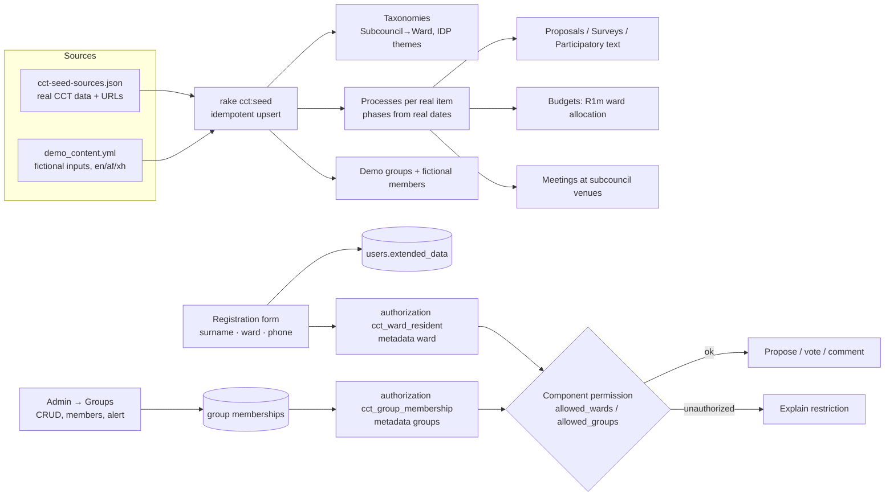

# feat: CCT demo gap closure — real Cape Town data, af/xh, user groups, registration fields

---

## Summary

Turn the throwaway Decidim 0.32.2 demo into a convincing City of Cape Town (CCT) tender demo. The priority is a **one-command, repeatable seed of real CCT scenarios**: the 20 subcouncils and 118 wards, the IDP themes, and 25 real 2025–26 public-participation items with their real titles, summaries and source links. Citizen inputs are fictional and clearly labelled.

Three cheap gap closures support it:
- free AI machine translation of the interface into Afrikaans and isiXhosa;
- admin-managed **user groups** whose membership drives Decidim permissions;
- **surname / ward / phone** fields at registration, with ward-restricted participation.

Everything is built and tested on the local Docker stack first, then promoted with the existing `deploy/deploy.sh`.

---

## Problem Frame

The tender (92S/2026/27) scores a live demo at 60 of 100 functionality points. Our demo currently shows an empty Decidim with English only. The fit reports flagged:
- **User groups:** a "must" (p13, D2).
- **Registration and profile fields:** D2.
- **Trilingual capability:** D1.
- **Geographic targeting:** D4.

CCT's current platform (Go Vocal) is English-only and holds the same real items. A trilingual demo built on real CCT content is a direct contrast.

This is a demo, not production. We optimise for cost and speed and accept machine-translation quality.

---

## Requirements

- **R1. Real CCT data, one command:** an idempotent seed loads the following from `db/seeds/cct/cct-seed-sources.json`:
  - subcouncils and wards;
  - IDP themes;
  - real participation items as processes and components;
  - meetings at real subcouncil venues;
  - a ward-allocation budget with real sample projects.

  Re-running it updates the data rather than duplicating it.
- **R2. Honest content:** real items carry their official title, our summary and a source link. All citizen proposals, comments, votes, users and groups are fictional and visibly marked as demo content. No real personal data.
- **R3. Afrikaans and isiXhosa:** both are selectable everywhere. The interface is machine-translated at no cost (AI agents, no paid API) and labelled as such. Seeded content is provided in en/af/xh.
- **R4. User groups (tender D2):**
  - Admins create groups, add and remove members, and restrict actions (propose, vote, comment, answer survey) to one or more groups.
  - Admins can alert a group about a campaign (D4).
- **R5. Registration fields:** surname, ward (dropdown of the 118 wards) and mobile number, captured at sign-up and editable in the account. Email stays required. No SMS.
- **R6. Ward targeting:** an action can be restricted to residents of given wards, e.g. Ward 57's allocation vote is limited to Ward 57.
- **R7. Local first:** every unit is runnable and testable on the local Compose stack. Production changes only through `deploy/deploy.sh` after a local sign-off.
- **R8. Security and privacy:** follow `.ai/security.md` from the Decidim repo:
  - permission checks plus specs on every new admin endpoint;
  - organization scoping;
  - escaping;
  - personal data (surname, phone, ward) cleared on account deletion and included in "download your data".

---

## Scope Boundaries

**In:** the four items above, a demo-content disclaimer, local test harness, promotion to the live demo.

**Out:**
- human translation review;
- phone-only login / SMS OTP;
- leaderboard;
- reporting/BI dashboards;
- anonymous proposals;
- custom proposal fields;
- Go Vocal data migration;
- SES/SMTP fix (separate blocker).

### Deferred to Follow-Up Work
- Upstreaming af/xh translations to Decidim's Crowdin (good for the tender narrative, not needed for the demo).
- Ward boundary map overlays (GeoJSON licence for republishing unconfirmed).
- Reporting by ward/theme dashboard (tender D2 "reporting" gap).

---

## Key Technical Decisions

- **KTD1. All work lives in the app repo, not a Decidim fork.** Custom code goes in `lib/` and `app/` overrides or decorators plus one in-repo engine for groups. Decidim gems stay pinned at 0.32.2.
- **KTD2. Translation = Claude agents on extracted YAML, validated mechanically.** Extract every `en` key from the installed 0.32.2 gems inside the container (~6,300 strings across 17 modules). Chunk by module. Translate in parallel agent batches with a fixed glossary (official CCT terms: ward = wyk / iwadi, subcouncil = subraad / iBhungana…). Then validate:
  - same key set;
  - identical `%{…}` interpolations;
  - HTML tags preserved;
  - YAML parses;
  - pluralisation keys present.

  Output goes to app-level locale files that Rails loads after the gems. Cost: usage only. Afrikaans quality decent; isiXhosa weaker — accepted and labelled.
- **KTD3. Locale plumbing:**
  - `DECIDIM_AVAILABLE_LOCALES=en,af,xh`.
  - `rails-i18n` and `devise-i18n` already ship `af`. We add a minimal `xh` Rails base file (dates, numbers, plural rule) and `locale.name` entries ("Afrikaans", "isiXhosa").
  - The organisation's available locales are set by the seed.
- **KTD4. User groups via Decidim's authorization system, not a new permission model.**
  - Groups and memberships are org-scoped tables in an in-repo engine.
  - Membership changes sync a non-self-service authorization `cct_group_membership` whose metadata lists the user's groups.
  - A custom action authorizer (pattern: generator's `DummyActionAuthorizer` with `allowed_postal_codes`) checks an `allowed_groups` option.
  - Result: admins restrict any component action to groups through Decidim's existing Permissions UI. No core changes.
- **KTD5. Ward targeting uses the same mechanism:**
  - Registration auto-grants a `cct_ward_resident` authorization (metadata: ward number).
  - An `allowed_wards` option restricts actions.
  - Self-declared ward is acceptable for a demo; it is labelled "self-declared".
- **KTD6. Registration fields stored in `users.extended_data`** (surname, phone, ward) via form/command decorators and a view override of the registration and account forms. Phone is validated as a South African mobile (E.164 normalised `+27…`) and never shown publicly. Decidim's `DestroyAccount` does **not** clear `extended_data`, so we decorate it to wipe these keys.
- **KTD7. "Alert a group" = admin action that sends a Decidim notification** (in-app, plus email once SMTP works) to all members, linking to a chosen space. It reuses Decidim's event system rather than the newsletter, whose targeting can't select individual groups.
- **KTD8. Seed is a rake task over two data files:**
  - `db/seeds/cct/cct-seed-sources.json` (real, sourced);
  - `db/seeds/cct/demo_content.yml` (fictional inputs + af/xh translations, agent-generated, human-skimmable).

  It is idempotent: it upserts by stable keys (slugs / item URL). It never runs Decidim's own `db:seed`, which creates default accounts.
- **KTD9. Wards = 2026 delimitation (118).** Subcouncil mapping comes from the 30 Aug 2024 by-law. Wards 117/118 are placed by centroid inference and flagged `inferred: true` in the data. All of this goes in a seed note.
- **KTD10. Demo safeguards on a public URL:**
  - organisation name "City of Cape Town — Demo";
  - a sitewide "Demonstration only — not an official City of Cape Town platform" announcement;
  - `noindex` robots;
  - fictional users on `@example.org` addresses (unloginable);
  - CCT logo **not** used (OCL branding only).

  This avoids impersonating the City.
- **KTD11. Tests: RSpec in the app with `decidim-dev` factories** (already in the dev/test Gemfile group). Run via a `test` Compose profile with its own Postgres. Specs focus on new code (permissions, authorizers, decorators, seed idempotency), not Decidim internals.

---

## High-Level Technical Design

**Data and permission flow**



**Translation pipeline**

```mermaid
flowchart LR
  E[Extract en keys from<br/>installed 0.32.2 gems] --> CH[Chunk by module<br/>~300 keys/batch]
  CH --> T1[Agent batches → af]
  CH --> T2[Agent batches → xh]
  GL[Glossary<br/>official CCT terms] --> T1 & T2
  T1 & T2 --> V{Validate: keys, %{vars},<br/>HTML, YAML, plurals}
  V -->|fail| CH
  V -->|pass| OUT[config/locales/decidim/af|xh/*.yml]
```

---

## Output Structure

```text
decidim-demo/
├── config/
│   ├── initializers/cct.rb                    # locales, authorization workflows, decorators load
│   └── locales/
│       ├── xh.rails.yml                       # base Rails xh (dates, numbers, plurals)
│       ├── cct.{en,af,xh}.yml                 # our own strings (groups, registration fields, disclaimer)
│       └── decidim/{af,xh}/<module>.yml       # machine-translated Decidim UI
├── lib/
│   ├── cct/authorizations/                    # ward + group action authorizers
│   ├── cct/decorators/                        # registration form/command, account form, destroy account
│   └── tasks/cct.rake                         # cct:seed, cct:i18n:extract, cct:i18n:validate
├── engines/cct_groups/                        # admin user-groups engine (models, admin controllers, permissions, views)
├── app/views/decidim/devise/registrations/new.html.erb   # override: extra fields
├── db/seeds/cct/demo_content.yml              # fictional inputs + translations
├── script/i18n/                               # extract/chunk/merge helpers for the agent pipeline
├── spec/                                      # rails_helper (decidim-dev), unit/request/system specs
└── docker-compose.test.yml                    # test profile (postgres + rspec runner)
```

---

## Implementation Units

### U1. Test harness and local reset loop

**Goal:** Make "change → local stack → verify" fast and repeatable before any feature work.
**Requirements:** R7, R8
**Dependencies:** none
**Files:**
- `docker-compose.test.yml`
- `spec/rails_helper.rb`, `spec/spec_helper.rb`, `.rspec`
- `Gemfile` (add `rspec-rails` to test group if not pulled by `decidim-dev`)
- `README.md` (local loop section)

**Approach:**
- The test profile builds the image with dev/test gems and points at a separate Postgres.
- `rails_helper` loads `decidim-dev` factories and test helpers.
- Document the loop:
  - local reset: `down -v` → `db:create db:migrate` → `cct:seed`;
  - spec run.

**Patterns to follow:** `decidim-dev/lib/decidim/dev/test/rspec_support/` helpers (v0.32.2).
**Test scenarios:**
- A trivial factory spec creates an organization and user and passes in the test profile.
- The test DB is isolated (dev data untouched after a spec run).

**Verification:** one green spec run in the test container; the local stack still boots.

### U2. Locale plumbing for af/xh

**Goal:** Afrikaans and isiXhosa selectable everywhere, falling back to English for any missing key.
**Requirements:** R3
**Dependencies:** U1
**Files:**
- `config/initializers/cct.rb`
- `config/application.rb` (i18n load path for nested `config/locales/**`)
- `config/locales/xh.rails.yml`
- `config/locales/cct.{en,af,xh}.yml`
- `deploy/env.production.example`
- `spec/i18n/locales_spec.rb`

**Approach:**
- `DECIDIM_AVAILABLE_LOCALES=en,af,xh`.
- I18n fallbacks `af→en` and `xh→en`.
- `locale.name` keys.
- A minimal xh Rails base (month/day names, date formats, number separators, `one/other` plural).

**Test scenarios:**
- Switching to `af` renders the home page with `lang="af"` and the language chooser shows "Afrikaans" and "isiXhosa".
- A key missing in `xh` falls back to English, not "translation missing".
- Date helpers render in xh without raising.
- An organization with available locales `[en, af, xh]` saves via the system form.

**Verification:** manual switch across home, process page and admin in all three locales on the local stack.

### U3. Machine-translation pipeline (af, xh)

**Goal:** Full Decidim UI strings translated at no cost, validated, committed.
**Requirements:** R3
**Dependencies:** U2
**Files:**
- `script/i18n/extract.rb` (run in container: dump `en` keys per installed Decidim gem)
- `script/i18n/validate.rb`
- `config/locales/decidim/af/*.yml`, `config/locales/decidim/xh/*.yml`
- `docs/i18n-glossary.md` (from research §6)
- `spec/i18n/translation_integrity_spec.rb`

**Approach:**
- Extract to per-module chunks of ~300 keys.
- Dispatch parallel translation agents, each with the glossary and strict rules:
  - preserve keys;
  - preserve `%{var}`;
  - preserve HTML and Markdown;
  - don't translate brand names, URLs or format strings like `%d %b`.
- Merge the results, then validate. Failed chunks go back for retry.
- Add a "machine-translated" note to the footer in af/xh (KTD2).

**Execution note:** validate the first module (core) end-to-end before fanning out the rest.
**Test scenarios:**
- Every af and xh file has exactly the `en` key set for its module (no missing/extra keys).
- For every key, the set of `%{…}` placeholders equals the `en` set.
- Strings with HTML tags in `en` keep the same tag names.
- All files parse as YAML; i18n-tasks or a custom check reports no syntax errors.
- Rendering a notification with interpolation (e.g. "%{author} commented") works in af and xh.

**Verification:** the integrity spec is green; a manual click-through shows no English islands on demo paths except intentional fallbacks.

### U4. Registration fields and ward authorization

**Goal:** Surname, ward and mobile at sign-up and in the account. Ward grants a ward-resident authorization usable for targeting. Personal data is handled correctly.
**Requirements:** R5, R6, R8
**Dependencies:** U2 (strings), U6 ward list (or the static ward list from the JSON if U6 is not ready)
**Files:**
- `lib/cct/decorators/registration_form_decorator.rb`
- `lib/cct/decorators/create_registration_decorator.rb`
- `lib/cct/decorators/account_form_decorator.rb`
- `lib/cct/decorators/update_account_decorator.rb`
- `lib/cct/decorators/destroy_account_decorator.rb`
- `lib/cct/decorators/download_your_data_decorator.rb`
- `app/views/decidim/devise/registrations/new.html.erb` (override)
- account form partial override
- `lib/cct/authorizations/ward_action_authorizer.rb`
- `spec/cct/registration_spec.rb`, `spec/cct/ward_authorizer_spec.rb`, `spec/cct/destroy_account_spec.rb`, `spec/system/registration_spec.rb`

**Approach:**
- Fields are stored in `extended_data` (`surname`, `phone_e164`, `ward`).
- Ward is a select of 1–118 labelled with subcouncil/area.
- On create or update, upsert a granted `cct_ward_resident` authorization (unique per user) with `metadata.ward`.
- Register the workflow with option `allowed_wards`, a comma list.
- Phone validation: SA mobile formats normalised to `+27XXXXXXXXX`; optional.
- **Never** render phone or surname publicly. The public display name stays `name`.

**Patterns to follow:**
- `decidim-core/app/forms/decidim/registration_form.rb`
- `decidim-core/app/commands/decidim/create_registration.rb`
- generator `dummy_authorization_handler.rb` (`DummyActionAuthorizer`, `allowed_postal_codes`)

**Test scenarios:**
- Registering with surname "Mbeki", ward 57 and phone "082 123 4567" stores `+27821234567` and grants a ward authorization with ward 57.
- An invalid phone ("12345") shows a field error and creates no user.
- An out-of-range ward (0, 119, "abc") is rejected.
- Ward is required; surname and phone are optional (or per final copy).
- Changing ward in the account updates the authorization metadata and doesn't duplicate it.
- An action restricted to `allowed_wards: 57` → a ward-57 user is ok, a ward-12 user is `unauthorized` with an explanation, an unauthenticated user is prompted to sign in.
- A surname containing `<script>alert(1)</script>` is escaped wherever shown (admin view, export).
- Account deletion removes `surname`, `phone_e164` and `ward` from `extended_data` and deletes the ward authorization.
- Download-your-data includes the three fields for the owner.
- A user in organization B can't be matched by an org-A ward authorization (org scoping).

**Verification:** a system spec runs the full sign-up → restricted vote (allowed and denied) locally.

### U5. Admin user groups engine

**Goal:** Tender D2/D4: admins create groups, add and remove users, assign group-based permissions, and alert a group.
**Requirements:** R4, R8
**Dependencies:** U1, U2
**Files:**
- `engines/cct_groups/` containing:
  - models `CctGroups::Group` (org, slug, translatable name/description) and `CctGroups::Membership`;
  - migrations;
  - admin controllers for groups, memberships (add by email, CSV import, remove) and alerts;
  - an admin permissions class;
  - admin menu entry under Participants;
  - views;
  - `lib/cct/authorizations/group_action_authorizer.rb`;
  - commands `CreateGroup`, `UpdateGroup`, `DestroyGroup`, `AddMember`, `RemoveMember`, `ImportMembersCsv`, `AlertGroup`;
  - event `GroupAlertEvent`;
  - specs `spec/cct_groups/**`.
- `Gemfile` (path gem)

**Approach:**
- Every query is scoped to `current_organization`.
- Membership commands resync the `cct_group_membership` authorization (`metadata.groups` = sorted slugs). Removing the last membership deletes the authorization.
- The authorization is admin-granted only: its workflow has no self-service form. A user lacking it sees "Ask an administrator to add you to the group".
- Alert: pick a group and a space, then send a notification to members via `Decidim::EventsManager`.
- Actions are logged with `Decidim.traceability` for the admin log.
- CSV import validates emails against users of the current organization only, reports unknowns, and caps the row count.

**Patterns to follow:**
- `decidim-admin` members controllers (`members_controller.rb`, `members_csv_imports_controller.rb`)
- `decidim-admin/app/permissions/decidim/admin/permissions.rb`
- the Decidim command/form/event patterns in `.ai/app-directories.md`

**Execution note:** write the permission specs first (security.md: a new endpoint without a permission spec is a blocker).

**Test scenarios:**
- **Permissions (each admin action: index, create, update, destroy, add/remove member, import, alert):**
  - org admin allowed;
  - participant denied;
  - unauthenticated user redirected;
  - admin of organization B gets 404/denied for organization A's group IDs.
- Creating a group with a duplicate slug in the same org fails; the same slug in another org succeeds.
- Adding a member creates an authorization with that group. Adding to a second group lists both. Removing one keeps the other. Removing all deletes the authorization.
- An action restricted to `allowed_groups: ward-57-committee`: a member is ok, a non-member is unauthorized, a member of only `ngo-forum` is unauthorized.
- CSV import with 3 valid emails, 1 unknown and 1 from another org adds 3 and reports 2 rejected; a CSV with a formula payload (`=HYPERLINK(...)`) is stored as text and escaped on render.
- A group name `` renders escaped in the admin list and in the alert notification.
- Alert sends exactly one notification per member and none to non-members; double submission doesn't double-send (idempotency token or confirm step).
- Deleting a group removes memberships and resyncs affected users' authorizations.
- Requests without a CSRF token are rejected (admin forms use Rails defaults; one spec asserts it).

**Verification:**
1. Locally, an admin creates "Ward 57 Ward Committee", imports members, and restricts proposal creation in a process to that group.
2. A member can propose and a non-member is blocked.
3. The alert notification shows up in the member's notifications.

### U6. CCT real-data seed

**Goal:** One idempotent command builds the full CCT demo from real sources plus labelled fictional inputs, in en/af/xh. **This is the main deliverable.**
**Requirements:** R1, R2, R3, R6, R4 (demo groups)
**Dependencies:** U2. U4/U5 for ward-restricted and group-restricted examples (the seed must run without them and skip those bits).
**Files:**
- `lib/tasks/cct.rake` (`cct:seed`, `cct:seed:reset_demo_content`)
- `lib/cct/seed/` builders: organization, taxonomies, processes, proposals, budgets, meetings, surveys, participatory texts, blog, pages, users, groups
- `db/seeds/cct/demo_content.yml`
- `db/seeds/cct/cct-seed-sources.json` (input)
- `spec/cct/seed_spec.rb`

**Approach:**
- **Organization:** name "City of Cape Town — Demo", locales en/af/xh, timezone Africa/Johannesburg, OCL colours, demo-disclaimer announcement, help pages, `terms-of-service` page.
- **Taxonomies:**
  - "Area": 20 subcouncils → 118 wards, with inferred ones flagged;
  - "Theme": 6 IDP priorities + 3 foundations;
  - "Directorate";
  - taxonomy filters attached to components.
- **Processes:** a process group "Have your say 2025–26".
  - One process per real item (25): official title, our summary, a "Source" link to the capetown.gov.za / govocal URL, phases derived from the real open and close dates, theme and area set.
  - Components by item type: comment-period items → proposals + survey; by-laws → participatory text (sections from the summary, fictional annotations); budget/IDP → proposals + meetings.
- **Budgets:** "Ward Allocations 2026/27" process with one budget per showcased ward (e.g. 5 wards, R1,000,000 each). Projects come from the 12 real sample ward projects; their amounts are marked "indicative".
- **Meetings:** subcouncil meetings and IDP public meetings at the real office addresses. Dates fall on the Nov 2026–Mar 2027 IDP drafting timeline.
- **Fictional layer (`demo_content.yml`):**
  - ~30 users on `@example.org` with obviously fictional names;
  - 3–8 proposals per process with realistic CCT concerns;
  - comments, supports/votes;
  - official answers using custom states (Received → Assigned to directorate → Under evaluation → Responded);
  - 3 groups: a ward committee, an NGO forum, a ratepayers' association.

  All content gets en/af/xh text, generated once by agents and committed.
- **Restriction examples:** one ward-allocation budget vote restricted to its ward (U4), and one by-law consultation restricted to the ward-committee group (U5).
- **Idempotency:** upsert by stable keys (process slug from the item URL, user email, taxonomy key). Never touch real admin accounts. `reset_demo_content` deletes only seed-tagged records (tagged in `extended_data` or a seed-key column).

**Patterns to follow:** `decidim-participatory_processes/lib/decidim/participatory_processes/seeds.rb`, `decidim-proposals/lib/decidim/proposals/seeds.rb`, `decidim-budgets/lib/decidim/budgets/seeds.rb`, `decidim-meetings/lib/decidim/meetings/seeds.rb` (v0.32.2). Mirror the structure, but read from data files instead of Faker.

**Test scenarios:**
- On an empty DB: creates 20 subcouncil and 118 ward taxonomies, 25 processes, ≥1 budget with real project names, meetings at known venues, ~30 demo users. Counts asserted.
- Running twice yields identical counts (idempotent). Changing one item's summary in the JSON and re-running updates it in place.
- Every process derived from a real item has a non-empty source URL rendered on its page.
- Every fictional proposal and user carries the demo marker. No seeded user email outside `@example.org`.
- Every translatable field seeded has en, af and xh values.
- Running against an org with an existing real admin leaves that admin and their password untouched.
- `reset_demo_content` removes seeded records only. A manually created proposal survives.
- The seed runs successfully with U4/U5 absent (restriction examples skipped with a log line).
- Seeded text containing `<`/`&` renders escaped.

**Verification:** locally reset the stack, run `cct:seed`, then click through home → "Have your say" → a by-law text → a ward budget → a meeting in each language. Then rerun the seed: no duplicates.

### U7. Demo safeguards and promotion to live

**Goal:** Public-safe demo content, then promote to participate.opencitieslab.africa.
**Requirements:** R2, R7
**Dependencies:** U2–U6 signed off locally
**Files:**
- `public/robots.txt` (Disallow all)
- `config/locales/cct.*.yml` (disclaimer)
- `deploy/deploy.sh` (optional `--seed` flag running `cct:seed` after migrate)
- `deploy/env.production.example` (locales)
- `README.md`

**Approach:**
- Local sign-off checklist, then a manual EBS snapshot of the live instance.
- Deploy, then run `cct:seed` on the server.
- The existing "City of Cape Town" org is renamed to "City of Cape Town — Demo" by the seed.
- The existing admin and testers (Wasim, Khanya, Emily) are preserved.

**Test scenarios:**
- `robots.txt` disallows all.
- The disclaimer appears on every public page in all three locales.
- Smoke after deploy: home 200 in en/af/xh, `/system` still 403 from a non-allow-listed IP, a seeded process page renders, and the testers can still log in.

**Verification:** the live site shows the CCT demo content in three languages; the snapshot ID is recorded in the README log.

---

## System-Wide Impact

- **Upgrades:** decorators and overrides couple to Decidim 0.32.2 internals (registration form/command, account, destroy-account, registration view). Any 0.32.x bump needs a re-check; the specs in U4 catch regressions.
- **Existing live users:** the U4 migration adds no columns (it uses `extended_data`). Existing users have no ward. Ward-restricted actions prompt them to set it in the account.
- **Admins:** a new Participants → Groups menu. The Permissions UI shows two new authorization types.

---

## Risks & Dependencies

| Risk | Mitigation |
|---|---|
| isiXhosa machine translation reads poorly to CCT evaluators | Label it machine-translated. Native-speaker review of only the ~50 strings on the demo path if time allows. Demo mainly in en, switching language to show capability |
| Translation agents break placeholders or HTML | Mechanical validator (U3) blocks the merge; failing chunks are retried |
| Real data inaccuracies (ward 117/118 mapping, two venue addresses, budget amounts from PDF) | Flag inferred values in data. "Indicative" label on amounts. Avoid quoting those numbers in the demo script |
| Public demo mistaken for an official City site | KTD10 safeguards: "— Demo" name, disclaimer, noindex, no CCT logo |
| Decorators conflict with Decidim internals on 0.32.x patch | Pin 0.32.2. Specs around each decorator |
| Seed over existing live data | Idempotent upserts, demo markers, snapshot before running on prod |
| Machine time / agent usage for ~12,600 translations (2 langs × 6,300) | Batch by module. Core + admin + proposals + processes + budgets + meetings first (≈75% of the demo surface) |

---

## Open Questions

### Resolved During Planning
- Translation approach → free AI agents, no review (user, 2026-11-05).
- User groups shape → admin-managed groups (tender p13 wording).
- Phone sign-up → field only, email still required (user).
- Ward set → 2026 delimitation, 118 wards.

### Deferred to Implementation
- Exact decorator mechanism (`Module#prepend` vs `class_eval` in `to_prepare`), whichever matches Decidim conventions in 0.32.2.
- Whether the admin needs a "participants by ward" count view for the demo (cheap if time allows; supports the reporting narrative).
- Which 5 wards to showcase in budgets. Pick wards with real sample projects in the JSON.

---

## Sources & Research

- `docs/research/2026-11-05-cct-public-participation-sources.md` and `db/seeds/cct/cct-seed-sources.json`: 20 subcouncils, 118 wards, 9 themes, 25 real items, 2026/27 budget (R87.71bn; ward allocation R1m/ward), venues, af/xh glossary. Every row has a source URL.
- Tender 92S/2026/27 p13 (D2 user groups; D4 campaign alerts and geographic linking), p12 (D1 languages).
- Decidim v0.32.2:
  - `decidim-core/app/forms/decidim/registration_form.rb`, `app/commands/decidim/create_registration.rb`;
  - `app/commands/decidim/destroy_account.rb` (does not clear `extended_data`);
  - `decidim-verifications/lib/decidim/verifications/default_action_authorizer.rb`;
  - generator `dummy_authorization_handler.rb` / `verifications_initializer.rb`;
  - `decidim-admin/app/forms/decidim/admin/selective_newsletter_form.rb`;
  - `decidim-core/lib/decidim/core.rb` (available locales);
  - module seeds files.
- Installed gems: `rails-i18n` and `devise-i18n` ship `af`, no `xh`.
